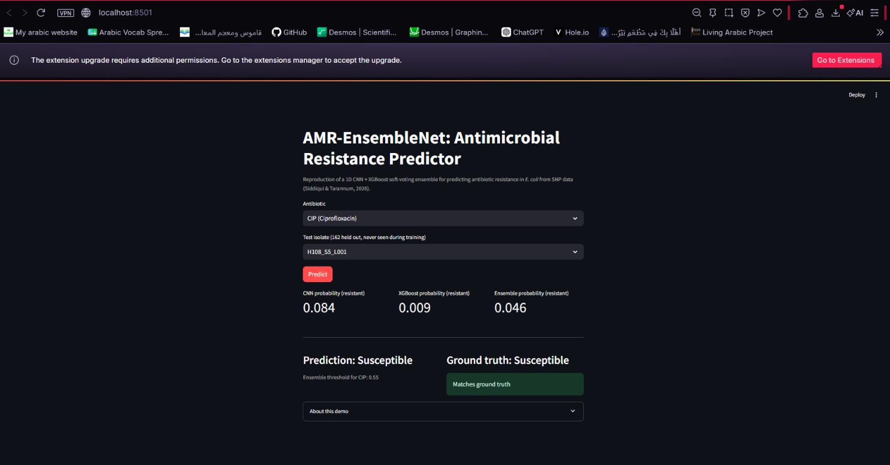

# AMR-EnsembleNet Deployment

A Streamlit app that serves the reproduced 1D CNN + XGBoost soft-voting
ensemble. Pick an antibiotic and a held-out test isolate; the app returns the
CNN probability, the XGBoost probability, the blended ensemble probability,
the predicted label, and the real ground-truth label for that isolate.

## How to start the app

From the repository root:

```bash
cd ML_Paper_Reprod/deployment
pip install -r requirements.txt
streamlit run app.py
```

This opens the app at `http://localhost:8501`.

**Windows note:** installing `tensorflow` can fail with an `OSError` on paths
like `...\tensorflow\include\external\...` if Windows Long Path support is
off. If `pip install` fails that way, create the virtual environment at a
short path (e.g. `C:\tfenv`) instead of inside a deeply nested project
folder, and install there:

```bash
python -m venv C:/tfenv
C:/tfenv/Scripts/pip install -r requirements.txt
C:/tfenv/Scripts/streamlit run app.py
```

## Dependencies

See `requirements.txt` in this folder (`streamlit`, `pandas`, `numpy`,
`scikit-learn`, `tensorflow`, `xgboost`, pinned to the same versions as the
main project's `requirements.txt` plus `streamlit`).

## Input format

The app does not take free-form input. SNP vectors are 60,936 features per
isolate, which isn't something a user can type by hand, so instead:

1. Pick an **antibiotic**: `CIP`, `CTX`, `CTZ`, or `GEN`.
2. Pick a **test isolate ID** from a dropdown. The dropdown only lists the 162
   isolates in that antibiotic's held-out 20% test split (reconstructed with
   the same `train_test_split(..., stratify=y, random_state=42)` call used
   everywhere else in the project) — so every isolate shown was never used to
   train the models being queried.

Internally, the app loads that isolate's real SNP row from
`Giessen_dataset/cip_ctx_ctz_gen_multi_data.csv` and its real label from
`Giessen_dataset/cip_ctx_ctz_gen_pheno.csv`; nothing is entered manually.

## Output format

After clicking **Predict**, the app displays:

| Field | Meaning |
|---|---|
| CNN probability (resistant) | Sigmoid output of the per-antibiotic 1D CNN |
| XGBoost probability (resistant) | `predict_proba` output of the per-antibiotic XGBoost model |
| Ensemble probability (resistant) | `0.5 * CNN + 0.5 * XGBoost` |
| Prediction | `Resistant` if the ensemble probability ≥ the paper's fixed threshold for that antibiotic (0.55 for CIP/CTZ, 0.48 for CTX/GEN), else `Susceptible` |
| Ground truth | The isolate's real lab-measured phenotype label, with a match/mismatch indicator |

## One worked example, end to end

Antibiotic: **CIP**, isolate: **H108_S5_L001** — captured live from the running
app (see screenshot below).

| Field | Value |
|---|---|
| CNN probability | 0.084 |
| XGBoost probability | 0.009 |
| Ensemble probability | 0.046 |
| Threshold (CIP) | 0.55 |
| Prediction | Susceptible |
| Ground truth | Susceptible |
| Match | Yes |

A second, script-reproduced example (antibiotic CIP, isolate
`RBL-17-0409-1_S127`): CNN 0.023, XGBoost 0.015, ensemble 0.019, prediction
Susceptible, ground truth Susceptible, match — reproduced by directly calling
the same `get_test_split` / `predict_one` functions `app.py` uses, outside
Streamlit.

## Screenshot


